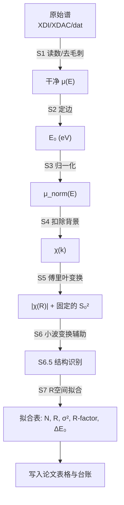

# XAFS 数据处理用户指南（操作导向版）

> **一句话**：拿到谱文件后，3 分钟跑完管线，5 分钟读懂拟合表，决定能不能放进论文。  
> **本文档面向**：首次使用本仓库处理 XAFS/EXAFS 数据的科研人员。  
> **核心承诺**：正文只讲“准备数据 → 跑命令 → 看图判读 → 排错”；所有物理公式和推导均收录在附录，不阻塞操作。  
> **导出 PDF**：用 Typora / Obsidian / VS Code Markdown PDF 插件打开本文件，`文件 → 导出 → PDF` 即可。图片请保持与 `.md` 同级。

---

## 0. 适合谁？能做什么？

| 适合场景 | 不适合场景 |
|:---------|:-----------|
| 有 XDI / XDAC / 纯文本 dat 原始谱 | 需要做长程晶体结构解析（那不是 EXAFS 能力范围） |
| 想知道吸收原子周围**几个邻居（N）、距多远（R）、多乱（σ²）** | 完全不清楚元素/边/化学态，且不愿先确认化学四问 |
| 有 XRD、CIF 或文献结构作为先验（可选，无也可走 L1 第一壳） | 指望管线自动“猜”出吸收元素（管线不会猜，不明确则拒绝运行） |
| 单原子催化剂（SACs，仅第一配位层 M–N/C/O 定性定量） | 重叠近邻配位原子（如 N 与 O，后向散射振幅和相移极度接近，常规 EXAFS 极难无偏差解耦，需结合 XANES/DFT 约束）；共线/接近共线构型的高壳层拟合（如 M–C≡N、M–C≡O），电子聚焦效应会使三体/四体多重散射强度远大于单散射，仅用单散射路径拟合高壳层无物理意义 |

---

## 1. ⚡ 极速上手卡（3 分钟跑通）

### 第一步：准备输入

确认你手头有以下四样（第 4 项无先验时可走 L1）：

1. **原始谱文件**：如 `sample_Fe.xdi`、`fe.060`（支持 XDI / XDAC / 纯文本 dat，可多扫描）。
2. **吸收元素与边**：如 `Fe K-edge`、`Pt L₃-edge`。若文件头无此信息，必须在命令行通过 `--absorber` 指定。
3. **化学态大致判断**：如“氧化物”“金属箔”“羟基氧化物”。这决定了 `S₀²` 的取值（见附录 D）。
4. **结构库确认**：确认常用骨架已在 `_structure_lib/<元素>/` 中，或手头有候选晶相的 `.cif` 文件；若已知特定晶相，可用 `--cif path/to/model.cif` 直接指定。

> 不确定元素或边？不要猜。先查文献或问课题组，管线在元素不明确时会直接报错退出。

### 第二步：敲命令（一行搞定）

```bash
# 完整管线：预处理 + 自动结构识别 + 定量 CN 拟合
python run_xafs.py data/sample_Fe.xdi --absorber Fe --fit -o xafs_out/sample_Fe
```

常用变体：

| 场景 | 命令补充 |
|:-----|:---------|
| 金属 Fe 单壳 bcc（严格只拟第一壳，表观距离截断） | `--fit-motif fe_bcc --chemical-state metal --fit-rmax 2.25` |
| 指定结构候选 | `--fit-motif goethite --allow-ambiguous` |
| 混合相 / 多位点权重拟合 | `--fit-weights` |
| 荧光模式（稀样品 / 薄膜，多通道探测器信号自动累加） | `--mode fluorescence` |
| 多元素批处理 | `python run_xafs.py a.xdi b.xdi --multi-element -o xafs_out/batch` |

所有输出统一落在 `xafs_out/sample_Fe/`，不覆盖已有结果。

### 第三步：看 3 个核心产物

| 产物 | 用途 | 重点看什么 |
|:-----|:-----|:-----------|
| `sample_Fe_xas.png` | 五联图（μ(E)、XANES、k²χ(k)、$\vert\chi(R)\vert$、WT） | FT 峰归属、WT 轻/重原子分布、边形是否正常 |
| `sample_Fe_fit_table.csv` / `sample_Fe_fit_table.png` | 定量拟合结果 | 每壳层 N、R、σ²、R-factor、误差棒 |
| `sample_Fe_indicators.csv` | 门禁核验 | R-factor、ΔE₀、S₀² 来源、phase_correction 状态 |

### 第四步：门禁核验（能不能放进论文？）

| 指标 | 合格阈值 | 不合格后果 |
|:-----|:---------|:-----------|
| $R\text{-factor}$ | $< 0.05$ 优质 / $0.05 \sim 0.10$ 基本可用（催化剂多壳层常见）/ $> 0.10$ 红灯 | $> 0.10$ 时模型或数据有问题，降级 |
| $|\Delta E_0|$ | $\le 5\text{ eV}$ 优质 / $5 \sim 10\text{ eV}$ 需核验 / $> 10\text{ eV}$ 红灯 | $> 10\text{ eV}$ 时 E₀ 定义或结构模型可能有偏，降级 |
| N 误差棒 | 体相参比样：N 接近理想整数；催化剂/纳米材料：误差棒合理（相对误差 ≤ 15%～20%）且 N 在物理上限以内 | 该壳层不可信，只报第一壳 |
| 吸收阶跃 Δμ₀ | 透射：0.5–1.0 最佳；>2.0 有厚度/针孔效应；<0.2 信噪不足 | 荧光：0.02–0.1 正常，需配合厚度评估自吸收 |
| $\sigma^2$（Debye–Waller） | 室温 $0.002 \sim 0.015\text{ Å}^2$，重无序不超 $0.020\text{ Å}^2$；$\sigma^2 \le 0$ 或 $> 0.020\text{ Å}^2$ 为红灯 | $\sigma^2 \le 0$ 非物理，必须降级；$\sigma^2$ 与 $N$ 强负相关（$N$ 偏大伴随 $\sigma^2$ 偏大） |
| 独立点数 N_idp | 建议 $N_{\text{var}} \le \frac{2}{3} N_{\text{idp}}$（即预留约 33% 自由度冗余；不宜仅满足 $N_{\text{idp}} > N_{\text{var}}$ 的下限，审稿通常要求更严） |
| 参数关联度 | 任意两变量 $\vert\rho\vert < 0.85$ 为绿灯；$0.85 \le \vert\rho\vert < 0.90$ 为黄灯；$\vert\rho\vert \ge 0.90$ 为红灯 | $\vert\rho\vert \ge 0.90$ 为严重简并，必须固定其中一变量或绑定物理约束 |

---

## 2. 核心工作流：从谱线到论文表格

正文不讲公式推导，只讲每个阶段“干什么、看什么”。详细公式见附录 A。

### 2.1 极简流程图



### 2.2 阶段速查

| 阶段 | 做什么 | 输入 | 输出 | 人怎么看 |
|:-----|:-------|:-----|:-----|:---------|
| **S1 读数** | 识别格式、换算 μ(E)、多扫描合并、去毛刺 | 原始文件 | 干净 μ(E) | 报错常因：把 I₀ 当成 μ、文件格式不识别 |
| **S2 定边** | 找吸收边能量 E₀ | μ(E) | E₀（eV） | 元素必须对；多谱对比或精密拟合前，优先用同步采集的参比箔（Reference foil，一阶导数峰）对齐光束线单色器漂移至标准值，E₀ 偏差可由拟合中的 ΔE₀ 吸收 |
| **S3 归一化** | 边前归零、边后归一到 ≈1.0 | μ(E)、E₀ | μ_norm(E)、Δμ₀ | 边后平台应在 0.85–1.15 之间 |
| **S4 扣背景** | 减孤立原子背景，得到 χ(k) | μ_norm(E)、E₀ | χ(k)、R_bkg | R_bkg 必须严格小于第一配位层表观距离起始上升沿（常规体系 1.0–1.1 Å）；若含短键（如 M=O ≈ 1.6 Å，表观 ≈1.2 Å），R_bkg 默认 1.1–1.2 Å 会把真实震荡当背景扣除！ |
| **S5 FT** | k 空间 → 距离域 $\vert\chi(R)\vert$ | χ(k)、k 窗口 | $\vert\chi(R)\vert$、r₁ | **FT 峰位未相位修正，系统偏短，不填论文** |
| **S6 WT** | 二维 (R,k) 色图 | χ(k)、r₁ | W(R,k) | **仅作为定性辨识背散射原子类型的辅助手段**（低 k 极大值对应 C/N/O 轻原子，高 k 极大值对应过渡金属重原子）；受不确定性原理制约，低 k/低 R 处分辨率差，边缘存在截断伪影（Cone of Influence），绝不可作为定量配位构型的单独证据。 |
| **S6.5 结构识别** | 与结构库指纹比对 | $\vert\chi(R)\vert$、WT | confident / ambiguous / no_match | 只是候选排序，不是结构确证 |
| **S7 CN 拟合** | 量出 N / R / σ² | CIF/motif、χ(k)、固定 S₀² | N, R, σ², R-factor | **核心定量结果，见第 3 节判读** |

---

## 3. 结果三步判读法（红黄绿灯规则）

拟合表出来后，按这三步走，不用纠结公式推导。

### 第一步：看整体可信度（R-factor 与 ΔE₀）

| 灯号 | 判定条件 | 含义 | 建议 |
|:-----|:---------|:-----|:-----|
| 🟢 绿灯 | $R\text{-factor} < 0.05$ 且 $|\Delta E_0| \le 5\text{ eV}$ | 模型极佳，可信 | 可直接放进论文 |
| 🟡 黄灯 | $0.05 \le R\text{-factor} \le 0.10$ 或 $5 < |\Delta E_0| \le 10\text{ eV}$ | 基本可用，需核查 | 催化剂多壳层常见；检查次级壳层、背景 $R_{\text{bkg}}$、k 窗口 |
| 🔴 红灯 | $R\text{-factor} > 0.10$ 或 $|\Delta E_0| > 10\text{ eV}$ | 模型选错或 E₀ 定错 | 降级为仅第一壳，或重新选结构候选 |

> **统一标准**：对于催化剂/氧化物多壳层拟合，`R-factor < 0.02` 极佳（通常只出现在单晶或纯金属箔），`0.02–0.05` 优良，`0.05–0.10` 基本可用。案例中出现的 `0.067` 属于黄灯范围，在复杂催化剂中只要 ΔE₀ 合格且 N 误差棒合理，可以放行写入论文，但需在脚注中说明。

### 第二步：看配位数 N 与 Debye–Waller 因子 $\sigma^2$（物理合理性）

**N 检验：**

> **体相参比样 / 金属箔（如 bcc-Fe、α-Al₂O₃）：** 应接近理想整数（8、6、4…）。若 N 偏离整数超出误差棒，通常提示厚度效应、拟合截断伪影或结构模型错误，应优先排查 `--fit-rmax` 是否切入高壳层、S₀² 是否选错、或样品是否偏厚。

> **催化剂 / 纳米材料 / 高分散体系：** 非整数配位数才是常态和物理真实（如表面原子配位不饱和、晶格畸变、氧空位）。绿灯判定标准为：**误差棒合理（相对误差 ≤ 15%～20%），且 N 处于合理的物理上限以内（如第一壳不超过体相配位数）**。此时 N 代表平均有效配位数（Average Coordination Number），具有明确的表面结构和分散度物理意义，可直接写入论文表格并标注为“有效配位数”。

- 🟢 绿灯：体相参比样 N 接近理想整数；催化剂/纳米材料误差棒合理且 N 在物理上限以内 → 壳层可信，记入论文表格。
- 🟡 黄灯：N 非整数但误差可接受 → 可能是壳层合并或部分失序，标注为“有效配位数”，谨慎解读。
- 🔴 红灯：N 出现负数、极大误差（如 $4.2 \pm 12.8$）→ 参数不可独立确定，**必须降级为仅拟合第一壳层（L1）**。

**$\sigma^2$ 检验：**
- 室温下常规壳层合理区间：$0.002 \sim 0.015\text{ Å}^2$（低对称或重无序不超 $0.020\text{ Å}^2$）。
- 🔴 红灯：$\sigma^2 \le 0$（非物理）或 $> 0.020\text{ Å}^2$（严重发散），说明与 $N$ 发生强负相关（$N$ 偏大伴随 $\sigma^2$ 偏大），必须降级退守第一壳层（L1）。
- 即使 $R\text{-factor}$ 很小，$\sigma^2$ 非物理也不可接受。

### 第三步：看键长 R 与相移校正（致命坑提醒）

⚠️ **FT 图（$|\chi(R)|$）的横坐标峰位不是真实键长**——因为光电子相移会使峰位系统偏小 0.3～0.5 Å。

- **论文正文和表格必须且只能采用 `fit_table` 里的拟合值 R**（经过相位修正）。
- FT 图只能用于定性定位壳层，不能引用峰位作为键长。

---

## 4. 避坑与诊断决策树（FAQ）

### 4.1 常见控制台错误拦截

| 现象 | 可能原因 | 解法 |
|:-----|:---------|:-----|
| `ValueError / ChannelError: I0/I ratio median out of bounds` | 把荧光信号当透射了，或者通道列选错 | 检查原始文件，指定 `--mode fluorescence` 或手动指定列映射 |
| `ConvergenceError: N_idp <= n_varys` | 拟合窗口太窄或路径放得太多，导致过拟合（违反独立点数门禁） | 缩小 R 拟合上限（如 `--fit-rmax 2.2` 只拟第一壳），或减少自由变量 |
| `Structure ID: no_match` | 没有匹配的体相 Motif（弱结晶、非晶、掺杂团簇） | 退守 L1 单壳层：`--fit-rmax 2.1` 只拟第一壳 |
| `Structure ID: ambiguous` | 最优与次优候选难分 | 只做 L1 第一壳，不自动上多壳层；或人工指定 `--fit-motif` |
| 拟合 N 出现负值或极大误差 | S₀² 选错、结构模型不对、或 N–σ²–ΔE₀ 强相关 | 先降级到 L1 第一壳，再排查；**若 N–σ² 关联度过高（|ρ| > 0.85），开启多 k 权重联合拟合（如 --k-weights 1,2,3）** |
| SACs 中 C/N/O 轻元素重叠拟合 | M–C、M–N、M–O 后向散射振幅 F(k) 与相位 Φ(k) 极度接近，无外加约束下同时放入多条路径会导致严重过拟合与虚假配位数 | **严禁同时自由拟合 M–C/M–N/M–O 三条独立路径**。规范做法：统一按主导元素（如 M–N）等效单壳层拟合，报告“M-(N/C/O) 有效总配位数”；或结合 DFT 模型固定键长差进行约束拟合 |

> ⚠️ **荧光自吸收提醒**：荧光模式适用于稀样品（通常负载量 **< 3 wt%** 或厚度极薄）。高浓度样品若用荧光采集，容易发生自吸收效应（Self-absorption），导致实验震荡幅度被压缩，拟合出的配位数 **N 会系统性偏小**。高浓度样品建议优先使用透射模式；若必须用荧光，需提供样品总化学式、厚度、有效密度、入出射角进行 Booth 自吸收校正。**若无法获取精确密度/厚度进行 Booth 校正，需在论文中明确声明该荧光谱配位数 N 仅具半定量比较意义（可能系统性偏小），但拟合所得的键长 R 及其相对变化依然具有高度可靠的物理参考价值。**
>
> ⚠️ **WT 使用边界**：严禁从小波变换（WT）峰的强度直接定量估算配位数。WT 仅用作定性辅助佐证（如判断是否存在 M–M 重散射峰、辨认轻原子 C/N/O 与重原子），低 k/低 R 处分辨率差，边缘存在 Cone of Influence 截断伪影，绝不可作为定量配位构型的单独证据。
>
> ⚠️ **$\Delta E_0$ 与 $R$ 强耦合提醒**：$\Delta E_0$ 与拟合键长 $R$ 存在强相关（$\Delta E_0$ 偏大通常导致拟合出的键长 $R$ 偏长）。当 $|\Delta E_0| > 10$ eV 时，拟合出的 $R$ 往往失去绝对参考价值，不应直接写入论文表格。


### 4.2 决策树（文本版）

```
开始：拟合表出炉
   │
   ├─ R-factor > 0.10 或 $|\Delta E_0|$ > 10 eV？
   │   ├─ 是 → 🔴 红灯：结构模型或 E₀ 可能错，降级至第一壳
   │   └─ 否 → 下一步
   │
   ├─ N 有负值 / 极大误差？
   │   ├─ 是 → 🔴 红灯：该壳层不可信，只报第一壳
   │   └─ 否 → 下一步
   │
   ├─ N–σ² 关联度 |ρ| > 0.85？
   │   ├─ 是 → 🟡 黄灯：开启多 k 权重联合拟合（如 --k-weights 1,2,3），仍不可分则降级 L1
   │   └─ 否 → 下一步
   │
   ├─ N 接近整数且误差棒合理？
   │   ├─ 是 → 🟢 绿灯：可记入论文表格
   │   └─ 否 → 🟡 黄灯：标注为“有效配位数”，谨慎解读
   │
   └─ 论文表格填写：只用 fit_table 里的 R，不要用 FT 峰位
```

---

## 5. 完整实战案例：Fe 标定 → 未知样品拟合

### 5.1 背景设定

- **标准样**：Fe 金属箔，用于确认 Fe 的 `S₀²`。
- **未知样**：某 Fe/TiO₂ 催化剂，怀疑含 Fe 氧化物种，想测 Fe–O 配位数和键长。

### 5.2 第一步：金属箔标定与管线基准校验（Benchmark/QC）

EXAFS 振幅项为 `N × S₀²`，二者在数学上完全简并（相关系数 ρ = 1.0）。因此**标定 S₀² 时必须固定理论配位数 N，将 S₀² 作为唯一自由变量放开拟合**；反之，若预设 S₀² 去拟合 N，只能做“自洽验证（QC）”，不能称为 S₀² 标定。

#### 模式 A：标定 S₀²（固定 N=8，浮动 S₀²）

适用于已知晶体结构的金属箔参比样（如 bcc-Fe 第一壳 N=8），用于测得该光束线/实验条件下的实测 S₀²。

```bash
# Fe 金属箔标定 S₀²：固定第一壳配位数 N=8，浮动 S₀²
# 表观距离截截断（≤ 2.25 Å），避开第二壳峰（2.50 Å）
python run_xafs.py data/Fe_foil.xdi --absorber Fe --fit-motif fe_bcc --fix-n --float-s02 --fit-rmax 2.25 -o xafs_out/Fe_foil_S02
```

**预期终端输出（示例）：**

```
[INFO] Absorber: Fe K-edge
[INFO] E0 method: derivative, E0 = 7112.0 eV
[INFO] R_bkg = 1.10 Å
[INFO] Structure ID: confident (fe_bcc, score=0.012)
[INFO] Fit: N=8.00 (fixed), R=2.486 Å, σ²=0.0052 Ų, ΔE0=-3.4 eV, S0^2=0.80±0.02, R-factor=0.0041
[INFO] S0^2 source: fitted from Fe foil (N fixed at 8)
```

拟合收敛后，将 `S0^2=0.80±0.02` 记录为该体系的标定值。**若标定值低于 0.70**，应高度警惕金属箔厚度效应或双壳截断伪影，**切勿直接用于后续的 Fe-O 氧化物拟合**；氧化物体系建议采用文献推荐值或对应氧化物标样（如 α-Fe₂O₃ 标样）标定值。

#### 模式 B：管线基准校验 / QC（预设 S₀²，拟合 N）

适用于未知样品的前置自检：将参考值 `S₀²=0.80` 预设，拟合金属箔。若拟合出的 `N ≈ 8` 且 `R ≈ 2.48 Å`，表明实验谱和仪器状态正常；若 `N` 明显偏离 8，需先排查厚度效应、自吸收或 E₀ 定义问题，再进行未知样品拟合。

| 体系 | S₀² 取值 | 来源 | 说明 |
|:-----|:---------|:-----|:-----|
| 金属 Fe / 合金 | 0.78 ~ 0.85（标定） | 金属箔双壳联合标定 | 推荐使用 bcc 前两壳刚性约束联合拟合（ΔR₂ = ΔR₁ × 2/√3，σ₂² ≈ σ₁²）。若采用工程快速单壳初筛，截断上限应设为 `--fit-rmax 2.25`（表观距离，避开第二壳）；若标定值 < 0.70，需检查实验金属箔厚度效应。 |
| Fe 氧化物 / 羟基氧化物 | `0.803` | `absorber.py` 静态表 | 生产值，**不要替换**；未标定元素需显式 `--s02` |

**重要**：bcc-Fe 第一壳真实键长 R≈2.48 Å（第二壳 R≈2.86 Å），在**未相位校正的 FT 表观距离空间**中，第一壳峰位约落在 2.15 Å，第二壳峰位约落在 2.50 Å。`--fit-rmax` 对应表观距离（Apparent R），若要严格避开第二壳，单壳初筛的截断上限应设为 `≤ 2.25 Å`（两峰谷底）。若设为 2.60 Å，实际上已把第二壳峰（2.50 Å）完整切入，会导致拟合出的 N 和 σ² 系统失真。

> ⚠️ **单壳截断仅为工程快速初筛**：由于 bcc-Fe 第一壳与第二壳在未相位校正的 FT 谱上严重重叠（径向分辨率 ΔR ≈ π/(2Δk) ≈ 0.17 Å，k=3–12 Å⁻¹），单壳截断拟合会把第二壳左翼截进去，导致第一壳 N 和 σ² 系统偏离。标准做法应放开前两壳，并利用立方晶系刚性约束进行双壳联合拟合，再标定 S₀²。

> 📘 **$S_0^2$ 物理本质**：严格来说，$S_0^2$ 由吸收原子核电荷与内壳层电子重排决定，为原子/多电子本征性质，通常在 $0.80 \pm 0.10$ 间浮动。若金属箔拟合标定出的 $S_0^2$ 显著偏低（例如低于 0.70），主因通常是常温金属箔较厚引入的“厚度效应/针孔效应”压低了震荡振幅，或 bcc-Fe 第一/第二壳重叠引入了截断伪影，**并非真实的原子本征变化**。此时切勿强行套用该偏低值，氧化物体系建议采用文献推荐值或对应氧化物标样（如 $\alpha$-Fe₂O₃ 标样）标定值。FEFF 理论计算中纯金属与氧化物团簇的 muffin-tin 重叠势参数差异也会造成系统差。

### 5.3 第二步：未知样品拟合

#### 场景 A：样品匹配到已知晶相（正常多壳层拟合）

结构识别返回 `confident`，可直接多壳层拟合，`S₀²` 采用氧化物静态表 `0.803`：

```bash
python run_xafs.py data/unknown_Fe.xdi --absorber Fe --fit -o xafs_out/unknown_Fe
```

#### 场景 B：高分散 / 非晶 / 掺杂催化剂（结构识别 ambiguous 或 no_match）

不强行上多壳层，退守 L1 单壳层（只拟第一壳 Fe–O）：

```bash
# 截取第一配位层，只拟第一壳
python run_xafs.py data/unknown_Fe.xdi --absorber Fe --fit --fit-rmax 2.1 -o xafs_out/unknown_Fe_L1
```

若明确知道某种结构候选（如 goethite），也可人工指定。对衍射弱或高分散样品，**务必加上 R 窗口截断**，避免对无序次级壳层做全范围拟合导致参数简并：

```bash
# 已知晶相但衍射较弱：指定 motif 并限制拟合前两壳（R ≤ 3.2 Å）
python run_xafs.py data/unknown_Fe.xdi --absorber Fe --fit --fit-motif goethite --fit-rmax 3.2 --allow-ambiguous -o xafs_out/unknown_Fe_goethite
```

### 5.4 第三步：看图看表

以场景 A 为例，打开 `xafs_out/unknown_Fe/`：

1. **`unknown_Fe_xas.png`**：面板 (d) `\|χ(R)\|` 第一个大峰 ≈ 1.5–1.6 Å（未相位修正），对应 Fe–O；第二个峰 ≈ 2.8–3.0 Å，对应 Fe–Fe。面板 (e) WT 色图：高 k 处 Fe–Fe 信号仍在，低 k 处 Fe–O 衰减，符合预期。
2. **`unknown_Fe_fit_table.csv`**：
   - 第一壳：N≈5.8 ± 0.6，R≈1.99 Å（拟合值，经过相位修正），σ²≈0.006 Ų；
   - 第二壳：N≈3.2 ± 0.9，R≈3.05 Å，σ²≈0.008 Ų。
3. **`unknown_Fe_indicators.csv`**：
   - R-factor=0.067（🟡 黄灯，催化剂多壳层基本可用）
   - $|\Delta E_0|$ = +5.2 eV（黄灯，5–10 eV，催化剂多壳层可接受，需检查边前定义）
   - S₀² 来源：`absorber.py` 静态表（Fe 氧化物 0.803）

### 5.5 第四步：论文表格怎么填

| 壳层 | 散射路径 | 配位数 N | 键长 R (Å) | $\sigma^2$ ($10^{-3}$ Ų) | ΔE₀ (eV) | R-factor (全谱) |
|:-----|:---------|:---------|:-----------|:--------------------------|:---------|:---------------|
| 1 | Fe–O | 5.8 ± 0.6 | 1.99 ± 0.02 | 6.0 ± 1.5 | +5.2 ± 1.1 | 0.067 |
| 2 | Fe–Fe | 3.2 ± 0.9 | 3.05 ± 0.03 | 8.0 ± 2.2 | +5.2 ± 1.1 | — |

脚注示例：推荐多 k 权重联合拟合（$k^1, k^2, k^3$ 同时放开，打破 $N$–$\sigma^2$ 强简并）；**本例采用 $k^1, k^2, k^3$ 多权重联合拟合演示**；$S_0^2 = 0.803$（Fe 氧化物，absorber.py 静态表）；ΔE₀ 为全局共用变量（1 个变量，各壳层列出相同数值）；R 为相位修正后拟合值；FT 峰位未相位修正，未引用。R-factor = 0.067 为全谱统计量（属于催化剂多壳层可接受范围 0.05–0.10），不针对单壳层。拟合区间：$k = 3.0\sim 12.0\text{ Å}^{-1}$，$R = 1.0\sim 3.2\text{ Å}$；独立数据点数 $N_{\text{idp}} = 14.6$（按 Stern-Sayers 端点修正形式 $\frac{2 \Delta k \Delta R}{\pi} + 2$ 估算，$\Delta k=9.0\text{ Å}^{-1}$, $\Delta R=2.2\text{ Å}$；若采用不含端点修正的标准 Stern 判据 $\frac{2 \Delta k \Delta R}{\pi}$，则约为 12.6），拟合变量数 $N_{\text{var}} = 7$（含 1 个共用 ΔE₀）。

---

## 附录 A：物理公式与参数速查（正文不展开推导）

| 用途 | 公式 | 一句话含义 |
|:-----|:-----|:-----------|
| 波矢 | $k = \sqrt{\frac{2m_e}{\hbar^2}(E - E_0)} \approx \sqrt{0.2625 \cdot (E - E_0)}$ | 光电子动量，单位 Å⁻¹ |
| 吸收系数（透射） | $\mu(E) = -\ln(I/I_0)$ | 透射模式下的吸收强度 |
| 归一化 | $\mu_{\text{norm}}(E) = [\mu(E) - \mu_{\text{pre}}(E)] / \Delta\mu_0$ | 消除厚度/束流等实验因子 |
| 震荡谱 | $\chi(k) = [\mu(E) - \mu_0(E)] / \Delta\mu_0$ | 含结构信息的 EXAFS 震荡 |
| FT（复数） | $\chi(R) = \frac{1}{\sqrt{\pi}} \int_{k_{\text{min}}}^{k_{\text{max}}} k^n \chi(k) W(k) e^{-i 2 k R} \, dk$ | k 空间 → 距离域，$W(k)$ 为窗函数（常用 Hanning 窗，平滑两端截断以消除吉布斯旁瓣伪峰）；五联图展示其模长 $|\chi(R)|$ |
| EXAFS 理论 | $\chi(k) = \sum_j \frac{N_j S_0^2 F_j(k)}{k R_j^2} e^{-2\sigma_j^2 k^2} e^{-2R_j/\lambda(k)} \sin(2kR_j + 2\delta_c(k) + \delta_j(k))$ | S7 拟合核心，N/R/σ² 为拟合变量；$2\delta_c(k)$ 为中心原子双重视差相移，$\delta_j(k)$ 为背散射原子相移 |
| 指纹比对 | $\text{score} = \min_\alpha \frac{\|\chi_{\text{exp}} - \alpha \chi_{\text{theo}}\|^2}{\|\chi_{\text{exp}}\|^2}$ | score 越小越像该结构 |
| R-factor | $R\text{-factor} = \frac{\sum [\chi_{\text{exp}} - \chi_{\text{model}}]^2}{\sum \chi_{\text{exp}}^2}$ | 越小越好，<0.10 通常可接受；但随参数增加单调递减，不能单独证明新壳层真实存在 |
| 约化卡方（Reduced Chi-Square） | $\chi^2_\nu = \frac{\chi^2}{N_{\text{idp}} - N_{\text{var}}}$ | 引入新壳层后仅当 $\chi^2_\nu$ 明显下降时才统计学显著；若 $R\text{-factor}$ 微降但 $\chi^2_\nu$ 升高，属于过拟合，应退守单壳层 |
| 径向分辨率（Rayleigh 判据） | $\Delta R \approx \frac{\pi}{2 \, \Delta k}$ | k 窗口越宽，区分两个相近邻近壳层的能力越高 |
| 独立点数（Stern 规则） | $N_{\text{idp}} \approx \frac{2 \, \Delta k \, \Delta R}{\pi} + 2$ | 拟合参数数量 $N_{\text{var}}$ 严禁超过 $N_{\text{idp}}$，建议预留 30% 自由度冗余 |

### 核心参数速查

| 符号 | 名称 | 谁来定 | 是否拟合 |
|:-----|:-----|:-------|:---------|
| $N$ | 配位数 | 实验拟合 | ✅ 放开 |
| $R$ | 键长 | 实验拟合 | ✅ 放开 |
| $\sigma^2$ | Debye–Waller 因子 | 实验拟合 | ✅ 放开 |
| $S_0^2$ | 振幅降因子 | 标准样品标定 | ❌ 固定 |
| $\Delta E_0$ | 能量定标差 | 实验拟合 | **✅ 放开（吸收零点偏移）。多壳层拟合时必须作为全局共用变量（Global variable）绑定，严禁各壳层独立放开，否则会导致参数发散** |
| $R_{\text{bkg}}$ | 背景平滑参数 | 管线自动寻优 | ⚠️ 可人工指定 |

---

## 附录 B：CLI 参数与输出字典

### 常用命令

```bash
# 6. v2.0 界面负载催化剂（免 DFT：从 TiO2 切 (111) 面，Bridge 位自动锚定 Pt）
python run_xafs.py data/sample_Pt.xdi --absorber Pt --fit   --catalytic-model "algo:host=TiO2,surface=111,anchor=Pt,site=bridge,rcut=5.0"

# 7. v2.0 分子筛掺杂催化剂（免 DFT：ZSM-5 骨架 Al 位掺杂 Fe，注入 0.15 Å 轴向 Buckling 畸变）
python run_xafs.py data/sample_Fe.xdi --absorber Fe --fit   --catalytic-model "algo:host=ZSM-5,replace=Al,dopant=Fe,buckling=0.15,rcut=6.0"

# 8. v2.0 强静态无序/非晶催化剂（免 DFT：Co3O4 母体注入 σ=0.06 Å 静态高斯无序，配合 C3 偏斜拟合）
python run_xafs.py data/sample_Co.xdi --absorber Co --fit   --catalytic-model "algo:host=Co3O4,center=Co,disorder=0.06,rcut=4.5" --vary-c3
```

```bash
# 1. 常规处理（预处理 + 报告，不拟合）
python run_xafs.py 样品.xdi --absorber Fe -o xafs_out/样品名

# 2. 完整管线（结构识别 + 定量 CN 拟合）
python run_xafs.py 样品.xdi --absorber Fe --fit -o xafs_out/样品名

# 3. 指定结构候选，允许 ambiguous 也拟合
python run_xafs.py 样品.xdi --absorber Fe --fit --fit-motif goethite --allow-ambiguous -o xafs_out/样品名

# 4. 混合相 / 多位点权重拟合
python run_xafs.py 样品.xdi --absorber Fe --fit --fit-weights -o xafs_out/样品名

# 5. 金属 Fe 单壳 bcc（表观距离截断，避开第二壳）
python run_xafs.py foil.xdi --absorber Fe --fit-motif fe_bcc --chemical-state metal --fit-rmax 2.25
```

### 参数速查

| 参数 | 含义 | 典型值 |
|:-----|:-----|:-------|
| `--absorber` | 吸收元素 | 必填，如 Fe, Pt |
| `--e0-method` | E₀ 定义 | derivative / half_height / manual |
| `--fit-rmax` | 拟合 R 窗口上限 | **注意：此参数对应未校正相移的 FT 表观距离（Apparent R）**。实际晶体键长减去约 0.3–0.5 Å 即为表观位置。金属 Fe 第一壳截断建议取 2.25 Å，常规第一/第二配位层混合拟合建议 3.0–3.2 Å（避免引入未知多重散射）。 |
| `--kmin/--kmax` | k 窗口 | 3.0 / 12.0（不要贸然上 14）；平滑窗宽度 dk 默认 1.0（Hanning 窗），过宽过窄均直接影响 FT 峰高。**对于低载量或高噪谱图，若被迫将 k_max 降至 9.0~10.0 Å⁻¹，独立点数 N_idp 会显著下降，应更加警惕多壳层拟合带来的过拟合风险，必要时需严格限制拟合变量数或退守单壳层。** |
| `--rbkg` | 背景扣除截断距离 (Å) | 默认 1.0–1.1 Å。若体系含超短键（如高价 M=O、Mo≡N，表观峰落在 1.1–1.3 Å），必须压低至 0.8–0.9 Å，防止有效震荡被当作背景抹掉。**但不可盲目压低**：AUTOBK 样条背景的自由节点数正比于 $R_{\text{bkg}}$（$N_{\text{spline}} \approx \frac{2 \Delta k R_{\text{bkg}}}{\pi}$）。若体系中并无超短键而盲目将 $R_{\text{bkg}}$ 压至 < 0.8 Å，样条函数将失去灵活性，无法拟合真实原子吸收背景，残余低频背景会泄露至 $R < 1\text{ Å}$，形成非物理虚假峰干扰第一壳拟合。**若压低 $R_{\text{bkg}}$，必须同步确认低 $R$ 截断后样条函数在 k 空间的跟随性（即 $\mu_0(E)$ 是否仍能平滑穿过 $\mu(E)$ 震荡中心），防止引入极低频的非物理背景震荡。** |
| `--s02` | 显式振幅降因子 | 最高优先级 |
| `--chemical-state` | 化学态 | metal（用于金属 Fe） |
| `--cif` | 自定义晶体模型文件路径 | 覆盖库内 Motif 自动比对，用于已知特定晶相 |
| `--mode` | 测试模式 | transmission（透射，默认，可简写 trans）/ fluorescence（荧光，可简写 fluor） |
| `--fit-weights` | 混合相 / 多位点权重拟合 | 仅 kind="mixture"，softmax 放开组分权重（恒正、和=1） |
| `--allow-ambiguous` | 允许歧义候选强制拟合 | 结构识别非 confident 时也尝试 Top-1 拟合，谨慎使用 |

### 输出文件优先级

| 文件 | 优先级 | 重点看 |
|:-----|:-------|:-------|
| `*_indicators.csv` | ⭐⭐⭐ | R-factor、ΔE₀、S₀² 来源、各壳层参数 |
| `*_fit_table.csv` / `.png` | ⭐⭐⭐ | N、R、σ²、误差棒（论文表格来源） |
| `*_xas.png` | ⭐⭐ | 五联图，整体数据质量 |
| `*_meta.json` | ⭐⭐ | 决策轨迹、门禁命中 |
| `*_structure_id.json` | ⭐ | 结构识别结果（confident/ambiguous...） |

---

## 附录 C：开跑前确认（化学四问）

敲命令前请先心里有数：

1. **测的是哪个元素、哪条边？**（如 Fe K-edge）
2. **材料是什么？** 有 XRD、精修 CIF 或文献结构吗？
3. **化学组成是什么？**（化学式、负载量、载体）
4. **合成与后处理如何？**（气氛、温度、酸洗与否）

不确定时不要猜，先确认化学信息再运行管线。

---

## 附录 D：S₀² 优先级与取值

优先级：`--s02` > `--chemical-state` > `--s02-from-t5` > `absorber.py` 静态表。

| 元素 | S₀² | 适用体系 | 备注 |
|:-----|:-----|:---------|:-----|
| Fe | 0.803 | 氧化物 / 羟基氧化物 | 生产值，不要替换 |
| Fe | 0.78 ~ 0.85（标定） | 金属 Fe | 配 `--chemical-state metal`、`--fit-rmax 2.25`（表观距离） |
| Co / Ni / Cu / Pt | 0.7308 / 0.7795 / 0.8670 / 0.8075 | 金属箔 | 已标定 |

未标定元素需显式 `--s02` 或先标定。

> ⚠️ **$S_0^2$ 跨体系套用风险**：严格来说，$S_0^2$ 由吸收原子核电荷与内壳层电子重排决定，为原子/多电子本征性质，通常在 $0.80 \pm 0.10$ 间浮动。若标定值 **< 0.70**，主因通常是常温金属箔较厚引入的厚度效应，以及 bcc-Fe 第一/二壳重叠引入的拟合伪影，**并非价态变化导致的原子本征差异**。金属箔标定值 **不得直接套用**至氧化物/催化剂体系；氧化物体系建议采用文献推荐值或对应氧化物标样（如 $\alpha$-Fe₂O₃ 标样）标定值。FEFF 理论计算中纯金属与氧化物团簇的 muffin-tin 重叠势参数差异也会造成系统差。

---

> **说明**：本文档为用户操作手册，不涉及代码内部负载处理逻辑和开发维护约束。如需参与代码开发，请参阅单独的 CONTRIBUTING.md。